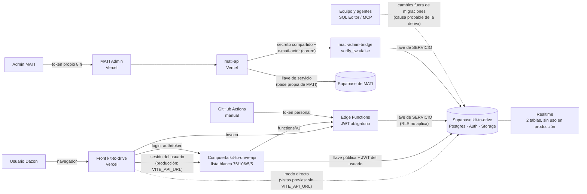

# Mapa de la aplicación (25 oct 2026)

Solo lectura. Sin secretos. Cada dato dice de dónde salió. Lo que no se pudo ver está en `LO-QUE-NO-SE-VERIFICO.md`.

## 1. Piezas

| Pieza | Qué es | Dónde corre | Llave que usa |
|---|---|---|---|
| Front `kit-to-drive` | Aplicación web de Dazon (Vite + React) | Vercel, proyecto `kit-to-drive` | Pública (`anon`) + sesión del usuario |
| Compuerta `kit-to-drive-api` | Proxy Express con lista blanca (repo `kit-to-drive-front`) | Vercel, proyecto `kit-to-drive-api` | Pública (`anon`) + la sesión del usuario que pasa |
| Base Supabase `kit-to-drive` | Postgres, Auth, Storage, Realtime | Supabase (Pro) | — |
| Edge Functions (7) | `admin-create-user`, `admin-update-user`, `admin-reset-user-password`, `complete-password-change`, `firmas`, `seed-demo-users` (apagada), `mati-admin-bridge` | Supabase | Pública + sesión solo para `auth.getUser()`; **servicio** para todo lo demás |
| `mati-api` | API de MATI (repo `mati-app`) | Vercel, proyecto `mati-api` | **Servicio** de su propia base y un secreto compartido hacia el puente |
| MATI Admin | Panel de administración (React) | Vercel, proyecto `mati-admin` | Ninguna llave de Supabase: habla con `mati-api` con un token propio |
| MATI App | Aplicación de clientes de MATI | Vercel, proyecto `mati-app` | Habla con `mati-api` |
| Repo `kit-to-drive-back` (= `kit-to-drive-web`) | Migraciones, funciones, pruebas, documentos | GitHub | Token personal de Supabase en Actions (solo despliegue manual de funciones) |

Pieza no listada en el encargo: **`mati-app`** (aplicación de clientes de MATI) y el proyecto de Vercel con otros 17 proyectos del mismo equipo (ver hallazgo O9).

## 2. Cómo se hablan

Quién **lee**: el front por la compuerta (tablas, vistas, RPC, buckets con URL firmada) y por Realtime solo en modo directo.
Quién **escribe**: el front por la compuerta con permisos del usuario (RLS); las Edge Functions y el puente con llave de servicio.

## 3. Llaves: dónde se usa cada tipo

| Tipo | Dónde | Evidencia |
|---|---|---|
| Pública (`anon`) | Front (`VITE_SUPABASE_PUBLISHABLE_KEY` y `VITE_SUPABASE_ANON_KEY`, ambas en Vercel, producción y vista previa); compuerta (`SUPABASE_ANON_KEY`); Edge Functions (solo `auth.getUser()`) | `src/integrations/supabase/client.ts`; `.env.example`; variables de Vercel (solo nombres) |
| De sesión (`authenticated`) | Todo lo que el usuario hace desde el front, directo o por la compuerta | `AuthContext.tsx`; `/tmp/gate/src/policy.ts` |
| De servicio (`service_role`) | Edge Functions `admin-*`, `complete-password-change`, `firmas`, `mati-admin-bridge`, `seed-demo-users` (apagada); `mati-api` con **su propia** base (`SUPABASE_SERVICE_KEY` en Vercel, producción **y vista previa**) | `supabase/functions/*/index.ts`; `mati-api/src/config/supabase.ts` |

**Ninguna llave de servicio llega al navegador:** no hay variables `VITE_*` con nombre de servicio; el código del front no contiene `service_role` (búsqueda en `src`, `.env.example`, `vite.config.ts`). El historial del front contiene un `.env` con una llave **pública** (`anon`), no de servicio.

## 4. Acceso a la base fuera de la compuerta

| Vía | ¿Existe? | Detalle |
|---|---|---|
| Front en modo directo | **Sí, en vistas previas** | `VITE_API_URL` solo existe en Producción; las vistas previas hablan directo con Supabase (permisos del usuario, sin lista blanca). Protegidas por inicio de sesión de Vercel (SSO). |
| PostgREST con llave pública | Sí, por diseño | Con la sesión de un usuario sirve lo que RLS permita. `anon` sin sesión no lee tablas (Fase 0). |
| Edge Functions con servicio | Sí | Ver `HALLAZGOS-OTRAS-CAPAS.md` (O1). |
| Puente `mati-admin-bridge` | Sí | `verify_jwt=false`; entra con secreto compartido comparado en tiempo constante (`index.ts:67–82`). |
| Conexión directa a Postgres | **No verificado** | Depende de la configuración de red de Supabase. |
| Tareas programadas (pg_cron) | No hay en el repo; **no verificado en producción** | |
| Webhooks de terceros | Ninguno en Kit-to-Drive. En `mati-api`: webhook de Stripe con firma (`STRIPE_WEBHOOK_SECRET`). | |
| SQL Editor y herramientas MCP | Sí | Quien tenga acceso al panel o a un token puede cambiar producción sin migración. |

## 5. Buckets (9, no 4)

El encargo habla de 4. Producción tiene **9** (`storage.buckets`, solo lectura). La lista blanca de la compuerta cubre 5.

| Bucket | Público | Límite | Tipos |
|---|---|---|---|
| `actividades-evidencia` | No | 10 MB | JPG, PNG, WebP, PDF |
| `clientes-docs` | No | 15 MB | PDF, JPG, PNG, WebP |
| `comentarios-fotos` | No | 5 MB | JPG, PNG, WebP, GIF |
| `evidencias-compras` | No | **sin límite** | **cualquiera** |
| `facturas` | No | 10 MB | PDF, imágenes |
| `finanzas-docs` | No | 20 MB | PDF, XML, imágenes |
| `firmas` | No | 15 MB | PDF, PNG |
| `refacciones-fotos` | **Sí** | 5 MB | JPG, PNG, WebP, GIF |
| `remisiones-docs` | No | 15 MB | PDF, imágenes |

## 6. Realtime

Dos tablas publicadas (`almacen_refacciones_movimientos`, `notificaciones`). Se suscribe un solo componente, `CampanaNotificaciones.tsx:41`, con la llave pública y la sesión del usuario, y solo si no hay compuerta. Ver `CRUCES-CON-FASE-0-Y-1.md`.
